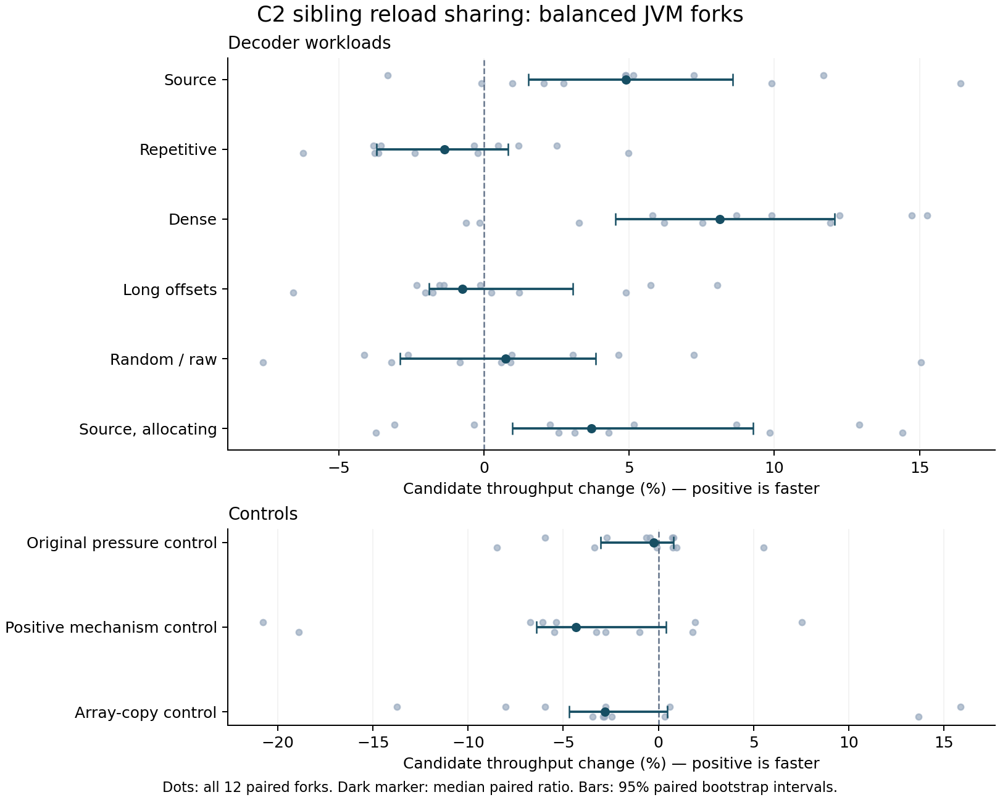

# C2 sibling spill-reload sharing: final evidence

## Decision and scope

Keep this as a **draft candidate for broader review and platform CI**. On this
Linux x86-64 AMD EPYC 9V74 VM, the final current-master source pair improved
source decode by **4.88%**, dense decode by **8.11%**, and allocating source
decode by **3.71%**. These are median paired throughput ratios from the complete
predeclared 216-fork matrix, with per-cell 95% paired bootstrap intervals.
Final allocation retains net reductions in stack transport in these decoder paths.

There are meaningful limits. The positive synthetic mechanism control estimates
**4.33% slower** (interval −6.41% to +0.40%), and array-copy control **2.81% slower**
(−4.70% to +0.47%). These do not establish regressions at the stated interval,
but do not exclude material losses either. Source startup peak RSS increased
by **3.36%** in paired ratios; arm medians rose from 91.54 to 94.20 MiB, about
**2.65 MiB**. This is not evidence of a universal win or regression-free behavior.
Cross-platform testing and broader workloads remain necessary before promotion.
No merge into master is requested or performed. PR51 cold-call work is separate;
none of its code or measurements qualifies this experiment.

## Source and build identity

| Role | Commit | Tree |
|---|---|---|
| Final stock A / fork master | `e7753d9dffffbf3a9430c2cc2ab53c5332bf1bf4` | `94e2438d2f55b76c8e360e35c10034c093635f06` |
| Final candidate B | `fee0b8411627e2fa207329190166b5fbcd3e9114` | `d071b1a0d884b69e758d5acbb08b682239204b09` |
| Preserved v5 starting point | `18963220078b0392b91f88acbf3fc6891155b3ef` | See retained history |
| Original historical stock | `815ff4dc327fe17f2433c7d115a5a503af10f3c4` | `576ca92576a193036464be6bed1be361d8f2d80f` |

The candidate product/test diff is nine files, 1,015 insertions. It retains the
v5 compiler logic and origin, integer/long, mask, dominance, call, debug-state,
pointer, tied-operand and repeated-definition guards. It runs after the first
physical split and rebuilds masks/liveness/interference through the normal path.
There is no opt-in product flag. Two test repairs were necessary: rename the
native fixture `Access` to `OriginAccess` to avoid a precompiled-header collision,
and add a valid positive trigger. The original pressure kernel had no eligible
origins because of Phi/tied/repeated definitions. Its 260 semantic cases remain;
the added helper supplies ordinary eligible computed-index uses with 24 live
longs across a noninlined barrier, plus 12,000 oracle/call-count checks. The trace
test still requires positive, unexhausted rewriting; no guard was relaxed.

All four complete release/fastdebug images were built with GCC 14.2.0, boot
JDK 27+35, mold, identical configuration, source date `1792181715`, and version
option `spillsharing`. Native x86-64, BMI2, four-CPU quota, 16 GiB memory.
`tools/configure.sh` records exact include/library/tool paths. Build and test
logs are in `final-e775/validation`; source and four image identities in
`final-e775/identity`. Release libjvm SHA-256:

* A: `96826dca38d25024a694126f5c356335bdb37f1e6dca6ec7059a0f2996aeaa83`
* B: `a94c99422b9f9cd3404d438d72922e369af38947a8df5e762c8ee61d9dfc53db`

Image comparison found **28,080 identical extracted module entries**, no module
entry differences, and identical CDS archives/classlists. Of other runtime files,
521 matched; only libjvm, its containing java.base.jmod, and release identity
differed. Both Java paths have 52 characters, and explicit CDS-on preflights
passed. No images were patched to equalize application or runtime content.

## Primary throughput: final source pair only

Positive changes mean faster. A is stock and B is candidate. Arm medians are
descriptive; the paired estimate is not the quotient of those two medians.

| Cell | Paired change | 95% interval | AB / BA | Arm medians A / B (ops/s) |
|---|---:|---:|---:|---:|
| decode-source | +4.88% | [+1.52%, +8.57%] | +2.40% / +5.01% | 114.131 / 121.431 |
| decode-repetitive | -1.36% | [-3.69%, +0.84%] | -3.00% / +0.07% | 2774.480 / 2732.338 |
| decode-dense | +8.11% | [+4.53%, +12.08%] | +4.74% / +11.07% | 210.749 / 228.942 |
| decode-long-offset | -0.75% | [-1.90%, +3.05%] | -0.76% / -0.75% | 37548.180 / 37796.824 |
| decode-random | +0.75% | [-2.90%, +3.85%] | -0.11% / +2.00% | 37401.198 / 38231.460 |
| allocating-source | +3.71% | [+0.97%, +9.27%] | +3.71% / +3.72% | 107.874 / 115.637 |
| spill-kernel4 | -0.26% | [-3.03%, +0.78%] | +0.34% / -0.53% | 465215.580 / 464264.888 |
| positive-trigger | -4.33% | [-6.41%, +0.40%] | -3.02% / -5.74% | 58177334.314 / 56173313.230 |
| copy-control | -2.81% | [-4.70%, +0.47%] | -2.64% / -4.36% | 32964.447 / 32135.744 |



Each cell has 12 independent JVM pairs: AB, BA, AB, BA, etc. Cells were
interleaved and rotated within each pair to distribute drift. One JMH thread,
CPU affinity 0–3, SerialGC, 512 MiB heap, ActiveProcessorCount=4, explicit
`-Xshare:on`, JMH 1.37, one fork/invocation, three one-second warmups and five
one-second measurement iterations. Builds, correctness tests, assembly capture,
throughput, cost and GC profiling ran separately. All 216 forks exited zero;
all observations/orders are retained, with no score-based retries or exclusions.

Estimator: median of five measurement iterations per fork, then median of the
12 within-pair B/A ratios. Intervals resample whole paired ratios 20,000 times,
seed 20261019. Intervals are per-cell 95%, **not simultaneous guarantees across
the nine cells**, and do not capture all host/configuration uncertainty. AB/BA
medians differ for some cells, notably dense; both orders retain its benefit.
The figure includes every paired observation. Protocol was fixed before these
timings: `tools/protocol-e775-final-source-before-timings.md`.

All decoder application source is unchanged `re-thc/jzstd` revision
`6abf77e2f63b68cc9269d5823e206235ab254c04`, using its public APIs, scripts and
`scripts/jdk27` documentation. `FrameBench` is an external JMH adapter, not an
application edit. It checks full allocating/direct decoded output and verifies
the direct destination after each trial. Fixed exact inputs and compressed frames
are in `corpus/`, with sizes and hashes in `corpus/manifest.json`. Source is the
Jackson databind 2.17.2 source payload; its source jar, license and notices are
retained. The random frame is the raw/uncompressed control. The original pressure
fixture and 1 MiB array-copy loop are controls. **Only the positive trigger uses
`-XX:+UseFPUForSpilling` in both arms**; ordinary real decoder cells use the
platform's default false. That trigger proves mechanism activation, not an
ordinary application speedup. Its negative timing is retained.

## Compilation, startup and memory costs

48 separate JVM invocations: 12 alternating pairs for source first-decode startup
and 12 for C2-only Xbatch full-output checking. Same paths/options/CDS as primary.
Wall time uses perf_counter, whole-process user+system CPU and peak RSS use
per-child wait4. Startup includes application initialization and the first full
source decode on a warm filesystem; it is not cold-disk or bare java-version
startup. Compiler seconds are aggregate CITime compilation elapsed time, **not
isolated compiler CPU**. CPU below includes the entire application process.
Seconds for elapsed/cpu/compiler metrics; KiB for peak RSS. Lower is better.

| Cell / metric | Paired change | 95% interval | Arm medians A / B |
|---|---:|---:|---:|
| startup / elapsed_s | +0.56% | [-3.77%, +13.22%] | 0.259904 / 0.263568 |
| startup / cpu_seconds | +2.81% | [-0.92%, +13.19%] | 0.525575 / 0.550321 |
| startup / resource.max_rss_kib | +3.36% | [+0.46%, +8.85%] | 93740.000000 / 96456.000000 |
| compiler / elapsed_s | -0.30% | [-4.70%, +3.77%] | 1.875189 / 1.819772 |
| compiler / cpu_seconds | -0.28% | [-4.54%, +3.76%] | 1.870178 / 1.816245 |
| compiler / resource.max_rss_kib | +0.11% | [+0.09%, +0.15%] | 203580.000000 / 203840.000000 |
| compiler / compiler_seconds | -0.71% | [-3.44%, +3.45%] | 1.246500 / 1.240500 |

Aggregate compilation time −0.71% and startup wall +0.56% have intervals spanning
zero. Startup RSS +3.36% and compiler-batch RSS +0.11% have positive intervals;
the latter arm medians differ by about 0.254 MiB. No memory-saving claim is made.
All 48 runs exited zero; raw observations and resources are in `final-e775/costs`.

## Allocation and GC profiling

12 additional JMH JVMs, two AB/BA pairs in each of three cells, with `-prof gc`.
These are separate diagnostic measurements; their throughput is not primary data.
Medians of per-fork median iteration normalized allocation, in bytes/operation:

| Cell | Stock A | Candidate B | GC observations |
|---|---:|---:|---|
| Direct source | 65,692.745 | 65,691.514 | No collections |
| Allocating source | 4,958,293.628 | 4,958,291.423 | A: 19/21; B: 20/22 collections; 8 ms per fork both arms |
| Positive trigger | 0.00006661 | 0.00005847 | No collections |

No material allocation advantage is established. The summary retains both
per-iteration medians and JMH aggregate metrics; these differ and should not be
interchanged. Raw five-iteration metrics are in `final-e775/gc-profile`.

## Final allocated code and frequency evidence

Twenty serialized final-source captures cover five corpora, two arms and both
release/fastdebug. Fixed 2,000 decoded operations, complete output verified,
Xbatch, two compiler threads, CDS on. Separate captures cover the actual JMH
dense/copy drivers. Complete allocated code bytes, disassembly and accounting
are published, including cold blocks, with zero undecoded bytes and zero unknown
stack operand widths. Counts include replacement stack work and register moves.
RSP memory excludes address calculations and stack-bang probes; MOV-family
register copies include extensions. These are **static counts**, not hardware
executed-load counts. Deltas below are candidate minus stock for the last normal
C2 compilation of each target in the fixed-operation capture:

| Corpus / method | Instructions | Stack loads | Stack stores | Load / store bytes | Register moves | Frame bytes |
|---|---:|---:|---:|---:|---:|---:|
| source / executeSequencesDirect | -9 | -10 | +0 | -32 / +0 | -1 | +0 |
| source / decodeSequencesRolling | -18 | -14 | -6 | -84 / -32 | +0 | +0 |
| repetitive / executeSequencesDirect | -7 | -9 | -4 | -64 / -24 | +7 | +0 |
| repetitive / decodeSequencesRolling | +0 | +0 | +0 | +0 / +0 | +0 | +0 |
| dense / executeSequencesDirect | -12 | -14 | +1 | -60 / +8 | -1 | +0 |
| dense / decodeSequencesRolling | -14 | -12 | -6 | -60 / -32 | +2 | +0 |
| long-offset / executeSequencesDirect | +0 | -2 | +0 | -8 / +0 | +3 | +0 |
| long-offset / decodeSequencesRolling | +0 | +0 | +0 | +0 / +0 | +0 | +0 |

Random/raw compiles neither target method as expected. In actual JMH captures,
dense rolling retains −14 instructions, −12 stack loads, −6 stores and +2 register
moves; dense execute has −3 instructions, −7 stack loads, no extra stores and
+2 register moves. Frames are unchanged. The copy-driver C2 stub has identical
instruction/transport/frame counts. This supports net transport removal but does
not explain away its negative throughput estimate.

Fastdebug TraceSpilling proves accepted unexhausted rewrites in the real source,
repetitive, dense and long-offset target methods; those records are in capture
JSON. `e775-frequency-accounting.json` maps allocated blocks and C2 profile
frequency estimates. Product builds omit PrintOptoAssembly, and fastdebug
allocation differs from release, so these frequencies are qualitative hot/cold
evidence, not exact product dynamic weights or hardware counters. Raw large
TraceSpilling logs remain locally retained with SHA-256/size inventory in
`identity/retained-local-trace-transcripts.json`; their extracted complete code,
frequency and activation evidence is published here. Do not infer a whole-app
gain from a count or apply old-base savings to this source pair.

## Correctness and allocator/GC safety

* Candidate native gtest: **13/13**, comprising nine sharing guards and four
  adjacent-constant guard integration tests from current master. Stock's four
  adjacent-constant guard tests also pass.
* Candidate jtreg: **13 selectors**, the complete 12-selector regalloc group
  (including Loads, Trace, Portable and GC) and current-master
  `compiler/c2/irTests/TestIfConstantThreshold.java`. Trace accepts seven rewrites
  with work 15,982, 527 nodes, 446 ranges, exhausted=0. The original semantic cases,
  full outputs/exceptions and new 12,000 positive oracle checks pass. Stock's
  Loads/GC selectors also pass.
* **70 selected codec tests** pass without skips on stock release, candidate
  release and candidate fastdebug: BlockDecoderTest, BoundsAndPoolTest,
  EdgeCaseTest and JzstdRemediationTest. Their ordinary project settings include
  `-Djzstd.adaptiveBlockSize=false -Xms512m -Xmx4g`. Earlier missing-property and
  undersized-heap harness failures were reproduced on stock/boot JVMs and
  preserved; application source was not changed to hide them.
* **85 full-output frame checks** pass on all three images: allocating/direct,
  offsets 0–15 and destination canaries, across all five exact frames.
* Manual live C2 call/frame/GC audits pass on both final-source fastdebug images:
  three forced collections, two active deoptimizations and four checked states.
  The first full GC moves roots/seeds arrays and all three boxes. The actual C2
  caller (compile 11) calls C2 callee (10) with return offset 292; caller oop map
  marks RBP=Oop. The callee frame is 160 bytes, saving RBP at SP+144 (frame−16),
  and the x86 walker supplies both VMReg halves for the saved link. Complete
  code/maps/actions and moved addresses are in `e775-gc-linked-frame-proof.json`
  and matching GC logs, rather than an inferred safe stack offset.

This is evidence on this native x86-64 machine, not proof for every architecture
or allocator shape. The draft keeps broader platform CI and review outstanding.

## Earlier experiments and unfavorable observations

`prior-416d7db/` preserves all earlier 384 throughput forks, all protocols, cost
and profiler records and earlier allocated code. Those data qualify their own
source pairs only. Before publication, master advanced from `416d7db` to `e775`
with a relevant C2 constant-guard change. The same nine-file patch was integrated,
all four images rebuilt, and the full final matrix and safety gates repeated.
Only `final-e775/` qualifies the proposed head.

Earlier default-setup dense cohorts gave +7.34% then +4.34%; their predeclared
24-pair pooled median was +5.92%. Copy pooled −1.94% with an entirely negative
interval. Follow-up equal-path explicit-CDS experiments exposed setup sensitivity:
CDS-on dense +6.54%, copy +1.01%; CDS-off dense +4.06%, copy +5.88%, with wide
intervals as retained. Earlier module/CDS outputs also differed in generated
metadata. These checks motivated equal path lengths and explicit CDS from the
start of the new final-source protocol. No single hardware cause was proven;
the earlier adverse copy result is not discarded. Final e775 module/CDS contents
match, but negative control estimates remain part of the current decision.

The original stock815/v5 builds and useful semantic/guard evidence remain local,
along with verified historical-image and Git-history archives. No retained
branch, image, trace or unfavorable record was deleted. The initial host's
32,361 orphaned zombies were reaped after explicit user approval; ordinary builds
and all final timings occurred after recovery. PID1 repair machinery is local
infrastructure work, not part of the compiler change or published benchmark.

## Reproduction and inventory

Recompute published final statistics without building Java:

```sh
python3 tools/analyze.py final-e775/throughput
python3 tools/summarize-costs.py final-e775/costs
python3 tools/plot-results.py final-e775/throughput/analysis.json throughput.png
sha256sum -c SHA256SUMS
```

`analyze-original.py` is the exact original analysis script. `analyze.py` only
resolves each raw result by basename next to runs.json, making the data portable;
the numeric method is unchanged. Recomputed final and retained 12-pair analyses
were byte-identical. The four-pair confirmation cohort intentionally does not
satisfy the original 12-pair assertion; its raw observations remain available.
Archived absolute command paths are execution provenance, not a requirement for
reading data. The tools run new measurements in the documented original layout.

For fresh runs, check out both exact JDK commits separately, use the same toolchain
and `tools/configure.sh` options, and build full release/fastdebug `make images`.
Install matching complete release images into `images/e775-a` and `images/e775-b`
under `/workspace/work/spill-sharing`. Use JMH 1.37 core/annotation processor,
jopt-simple 5.0.4 and commons-math3 3.6.1. Compile the unchanged jzstd
`src/main/java` with boot JDK 27 and `--add-modules jdk.incubator.vector`, compile
its public CodecProbe/DecodeOverlayCheck plus `tools/DecodeCapture.java` and
`tools/GCStateCapture.java` into `classes`, then compile the three benchmark
adapters and two packaged fixtures in `tools` using the JMH annotation processor.
Copy the exact corpus files into that layout. Build/test dependencies are jtreg
8.3dev+1, googletest 1.17.0 and JUnit console 1.11.4. Raw runs.json and capture
JSON record the full commands/options actually used; no adaptive stopping exists.

```sh
python3 tools/measure.py --baseline images/e775-a --candidate images/e775-b \
  --output fresh-throughput --pairs 12 --interleave-cells --jvm-arg=-Xshare:on
python3 tools/measure-costs.py --baseline images/e775-a --candidate images/e775-b \
  --output fresh-costs --jvm-arg=-Xshare:on
python3 tools/measure.py --baseline images/e775-a --candidate images/e775-b \
  --output fresh-gc --pairs 2 --profile-gc --jvm-arg=-Xshare:on \
  --cell decode-source --cell allocating-source --cell positive-trigger
```

Evidence lives on a separate branch/commit so the proposed product PR remains
nine files. SHA256SUMS covers every published file except itself. Full JVM
images/build trees/toolchains and oversized raw trace transcripts are retained
locally and identified here, rather than committed into the source PR.
